<h1 align="center">EKS Bank of Anthos Platform</h1>
<p align="center">

</p>
<p align="center">


</p>

<p align="center">
<strong>This repository is the public report.</strong><br/>
Terraform, GitOps manifests, CI, and application source stay in a private repository and are available on request.
</p>

Production-style **DevOps platform on Amazon EKS**: Terraform for infrastructure, GitHub Actions for image CI, Argo CD for GitOps, HTTPS at the edge, and a full metrics / logs / traces loop with Slack alerting and k8sgpt.

The banking UI is the open-source Bank of Anthos workload. The platform around it (VPC, EKS, CI, GitOps, TLS, secrets, observability, runbooks) is the work this project demonstrates. Screenshots below are from the validated run. Those hostnames are not served after teardown.

| Item | Value |
|------|--------|
| **Owner** | [oliversims](https://github.com/oliversims) |
| **Region** | `us-east-1` |
| **Cluster** | `bank-dev-eks` (Kubernetes `1.34`) |
| **Application** | https://bank.simsoliver.com |
| **GitOps** | https://argocd.simsoliver.com |
| **Metrics / logs** | https://grafana.simsoliver.com |
| **Traces** | https://zipkin.simsoliver.com |

## Contents

1. [Overview](#1-overview)
2. [Platform architecture](#2-platform-architecture)
3. [Service communication](#3-service-communication)
4. [Live application](#4-live-application)
5. [Platform evidence](#5-platform-evidence)
6. [CI/CD and GitOps](#6-cicd-and-gitops)
7. [Security and secrets](#7-security-and-secrets)
8. [Metrics](#8-metrics)
9. [Logs](#9-logs)
10. [Traces](#10-traces)
11. [AIOps](#11-aiops)
12. [High availability](#12-high-availability)
13. [Restore and tear down](#13-restore-and-tear-down)
14. [End-to-end flow](#14-end-to-end-flow)
15. [What this project demonstrates](#15-what-this-project-demonstrates)

---

## 1. Overview

| Capability | Implementation |
|------------|----------------|
| **Provision** | Custom VPC and EKS with Terraform; remote state in S3; stacks applied in blast-radius order |
| **Build** | Nine service images via GitHub Actions + Skaffold, published to `ghcr.io/oliversims/<service>` |
| **Deploy** | Argo CD Applications with auto-sync, prune, and self-heal |
| **Expose** | Dual ALB, ACM wildcard `*.simsoliver.com`, ExternalDNS |
| **Observe** | Prometheus, Loki, Zipkin, Grafana, Alertmanager, k8sgpt, Slack |

Workload namespace: `bank-of-anthos`. Python (`frontend`, `userservice`, `contacts`, `loadgenerator`). Java/Spring (`balancereader`, `ledgerwriter`, `transactionhistory`). PostgreSQL StatefulSets (`accounts-db`, `ledger-db`).

| Layer | Stack |
|-------|--------|
| Cloud / IaC | AWS `us-east-1` · Terraform (`vpc` → `certs` → `eks` → `secrets` → `observability` → `argocd`) |
| Kubernetes | EKS `1.34` · managed node group `t3.large` · Karpenter |
| Edge | Custom VPC · dual ALB · ExternalDNS · ACM |
| Identity | EKS Pod Identity · Secrets Store CSI · AWS Secrets Manager |
| Delivery | GitHub Actions + Skaffold → GHCR · Argo CD GitOps |
| Observability | Prometheus · Grafana · Alertmanager · Loki · Alloy · Zipkin · k8sgpt |

Private repository layout (not published here):

```text
infrastructure/     Terraform stacks and apply/destroy scripts
bank-of-anthos/     Application manifests (GitOps)
ingress/            Frontend Ingress and ACM host (GitOps)
argocd/             Argo CD Application CRs
src/                Microservice build context
.github/            Image CI
script/             deploy-app.sh · destroy-app.sh · check-az-spread.sh
k8sgpt/             Cluster analysis CR (applied by Terraform)
```

---

## 2. Platform architecture

CI/CD, Terraform, AWS networking, EKS namespaces, and Slack:

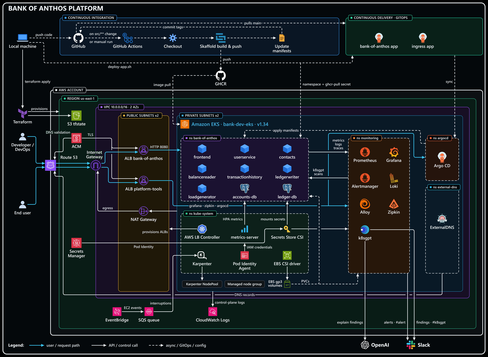

- **Two ALBs** — `bank-of-anthos` for `bank.simsoliver.com`; `platform-tools` for Grafana, Zipkin, and Argo CD
- **Private workers** in `10.0.10.0/24` and `10.0.11.0/24` (two AZs); public subnets for ALB, NAT, and IGW
- **GitOps split** — `bank-of-anthos/` (workloads) and `ingress/` (frontend ALB)
- **In-cluster Postgres** StatefulSets on gp3 PVCs (`accounts-db`, `ledger-db`)
- **Compute** — managed node group `bank-dev-private-ng` plus Karpenter

---

## 3. Service communication

HTTPS at the edge, HTTP between services, SQL to the databases, optional Zipkin spans:

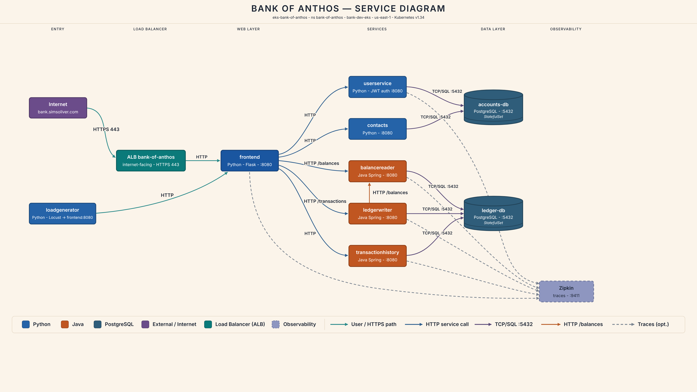

| From | To | Protocol |
|------|----|----------|
| Internet | ALB → `frontend:8080` | HTTPS → HTTP |
| `loadgenerator` | `frontend:8080` | HTTP (in-cluster) |
| `frontend` | `userservice`, `contacts`, `balancereader`, `ledgerwriter`, `transactionhistory` | HTTP |
| `ledgerwriter` | `balancereader` (`/balances`) | HTTP |
| `userservice`, `contacts` | `accounts-db:5432` | TCP/SQL |
| `balancereader`, `ledgerwriter`, `transactionhistory` | `ledger-db:5432` | TCP/SQL |
| App services | Zipkin (`:9411`) | HTTP spans |

---

## 4. Live application

HTTPS application from the validated run (`bank.simsoliver.com`):

<table>
<tr>
<td align="center" colspan="2">
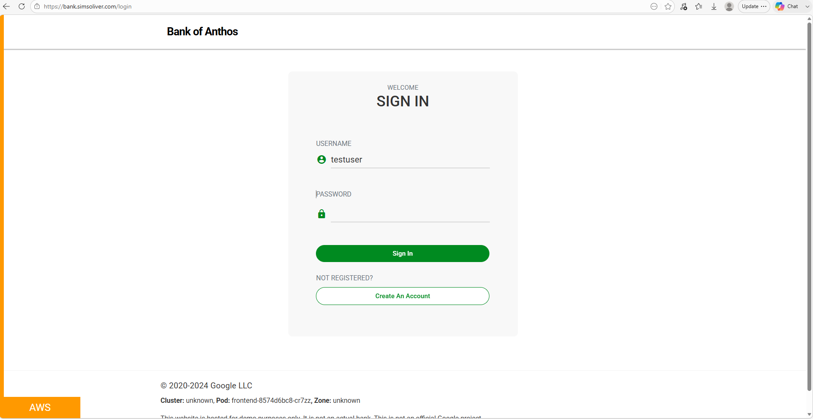
<br/><sub>Login</sub>
</td>
</tr>
<tr>
<td align="center" valign="top" width="50%">
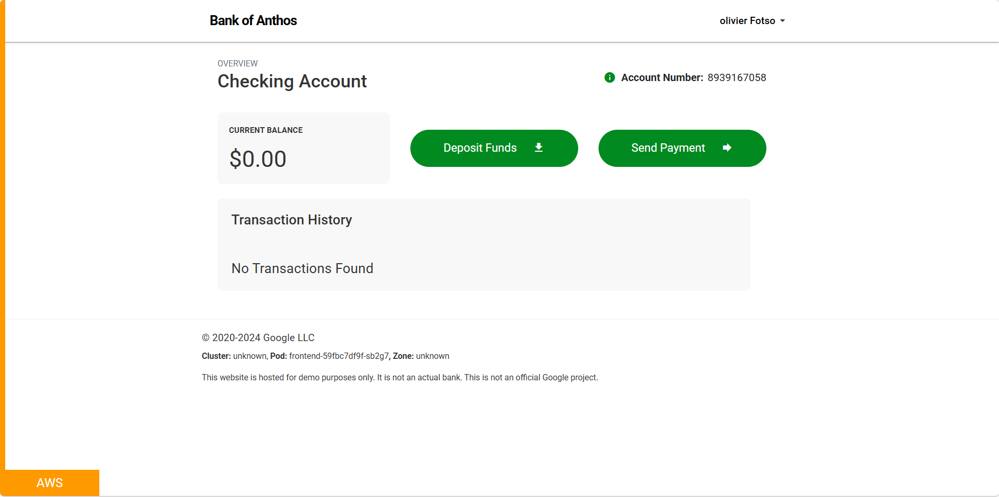
<br/><sub>Account overview</sub>
</td>
<td align="center" valign="top" width="50%">
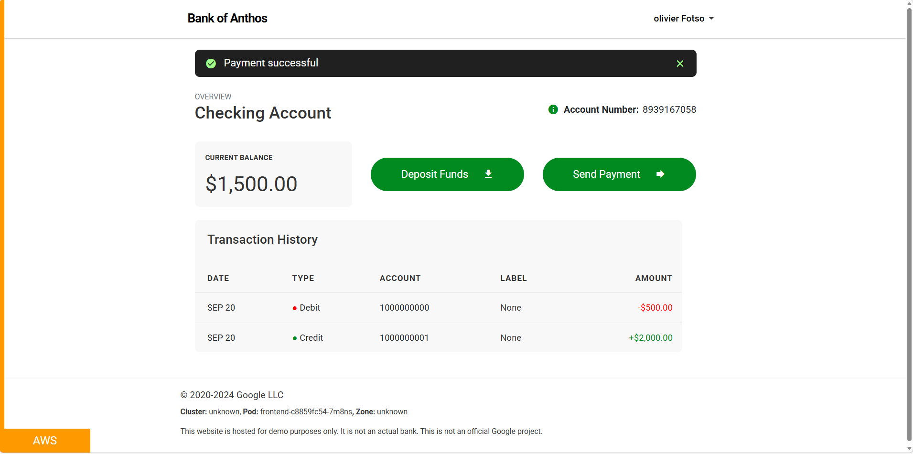
<br/><sub>Payment and ledger</sub>
</td>
</tr>
</table>

---

## 5. Platform evidence

AWS account access, then EKS compute (`t3.large` in two AZs) and running workloads:

<table>
<tr>
<td align="center" valign="top" width="50%">
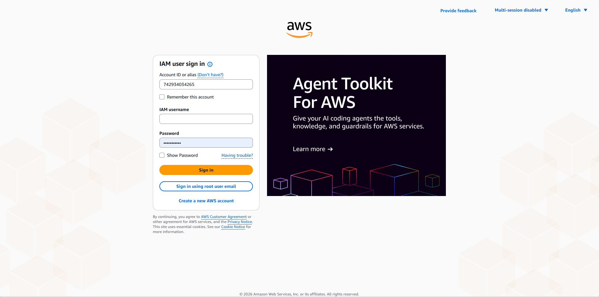
<br/><sub>AWS IAM sign-in</sub>
</td>
<td align="center" valign="top" width="50%">
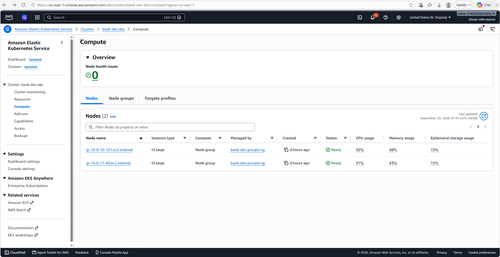
<br/><sub>EKS nodes</sub>
</td>
</tr>
<tr>
<td align="center" valign="top" width="50%">
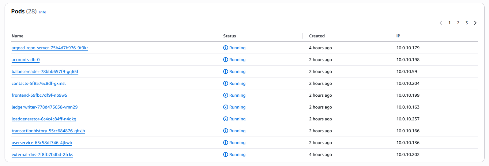
<br/><sub>Pods</sub>
</td>
<td align="center" valign="top" width="50%">
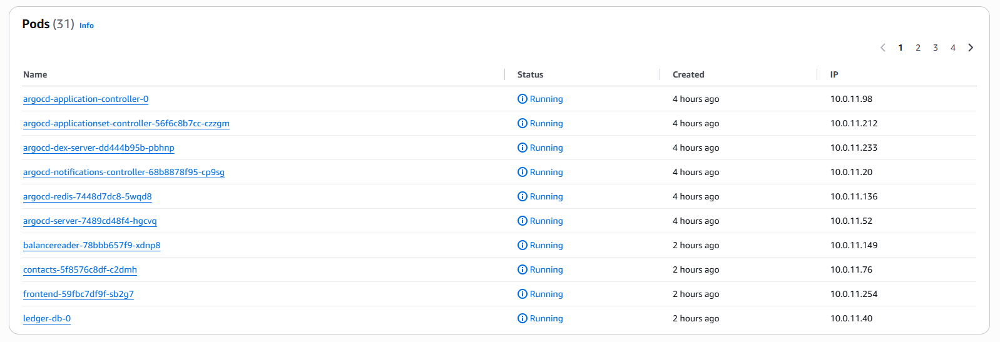
<br/><sub>Pods (continued)</sub>
</td>
</tr>
</table>

---

## 6. CI/CD and GitOps

Pushes to `main` under `src/**` run **Build and push images**: a **9-service** matrix, Skaffold builds, push to `ghcr.io/oliversims/<service>:sha-<commit>`, then a bot commit updates tags in `bank-of-anthos/`.

<table>
<tr>
<td align="center" colspan="2">

<br/><sub>GitHub</sub>
</td>
</tr>
<tr>
<td align="center" valign="top" width="50%">
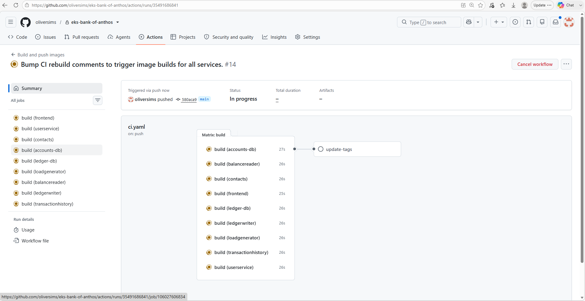
<br/><sub>Matrix in progress</sub>
</td>
<td align="center" valign="top" width="50%">
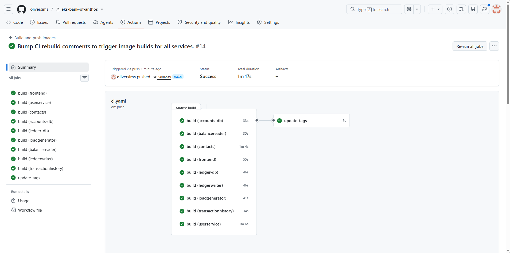
<br/><sub>Matrix complete + update-tags</sub>
</td>
</tr>
</table>

Argo CD watches `main` and reconciles two Applications (auto-sync, prune, self-heal):

| Application | Path | Destination |
|-------------|------|-------------|
| `bank-of-anthos` | `bank-of-anthos/` | namespace `bank-of-anthos` |
| `ingress` | `ingress/` | namespace `bank-of-anthos` |

<table>
<tr>
<td align="center" valign="top" width="50%">
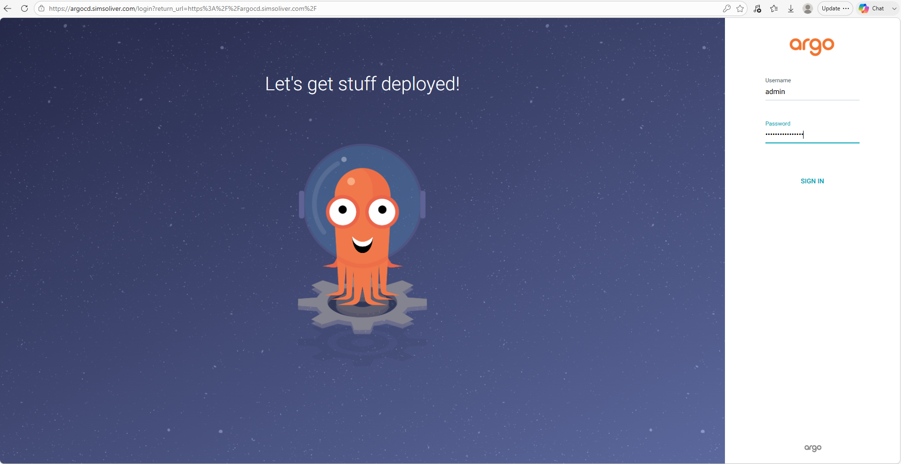
<br/><sub>Argo CD login</sub>
</td>
<td align="center" valign="top" width="50%">
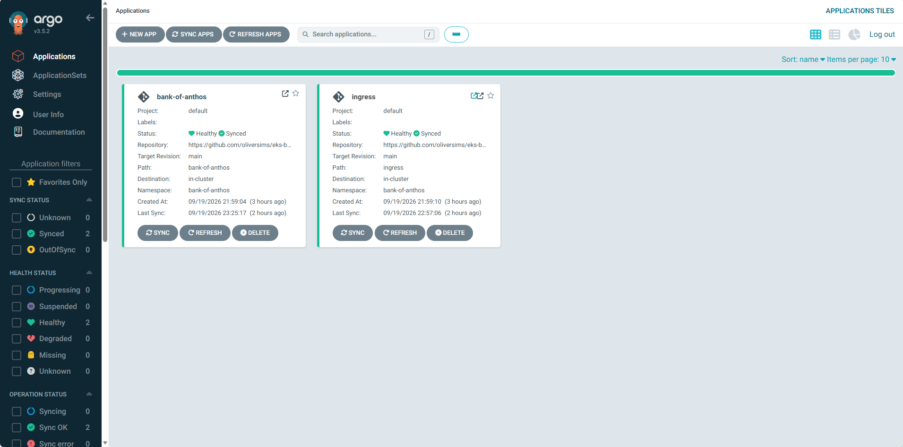
<br/><sub>Applications Healthy / Synced</sub>
</td>
</tr>
</table>

<table>
<tr>
<td align="center" valign="top" width="33%">
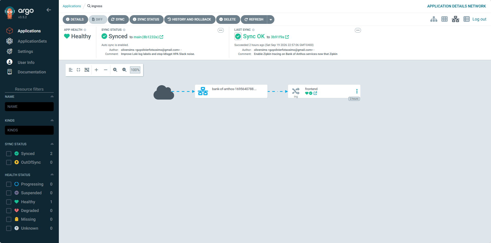
<br/><sub>ingress Application</sub>
</td>
<td align="center" valign="top" width="33%">
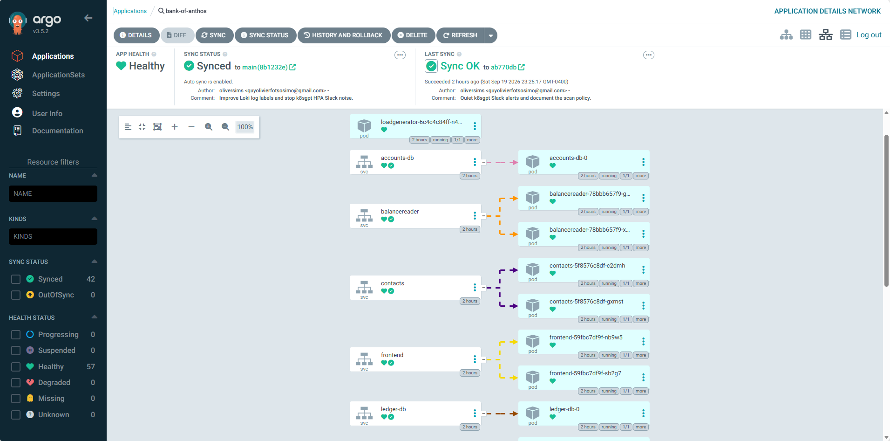
<br/><sub>Workloads (accounts / frontend)</sub>
</td>
<td align="center" valign="top" width="33%">
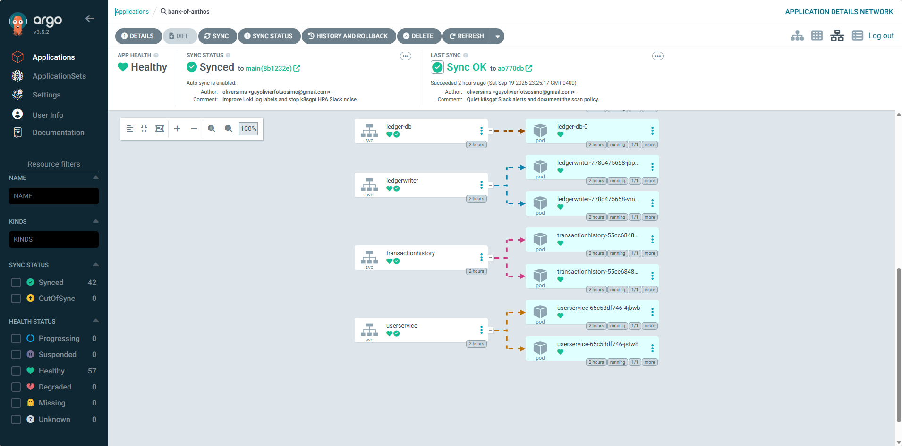
<br/><sub>Workloads (ledger / userservice)</sub>
</td>
</tr>
</table>

Deploy and destroy scripts in the private repository register the repo secret, apply the Applications, and tear down in reverse (ingress → app → secrets → namespace).

---

## 7. Security and secrets

- **EKS Pod Identity** for application and monitoring service accounts (no IRSA annotation sprawl)
- **AWS Secrets Manager** for JWT material, database credentials, Slack webhooks, and k8sgpt keys — nothing secret in Git
- **Secrets Store CSI** (AWS provider) mounts and syncs secrets through SecretProviderClasses
- Private node subnets; public subnets only for ALBs, NAT, and the internet gateway
- Cluster API public access restricted by a CIDR allow-list in Terraform

---

## 8. Metrics

Prometheus scrapes the cluster. Grafana (`grafana.simsoliver.com` during the run) shows CPU, memory, and network for namespace `bank-of-anthos`.

<table>
<tr>
<td align="center" colspan="2">
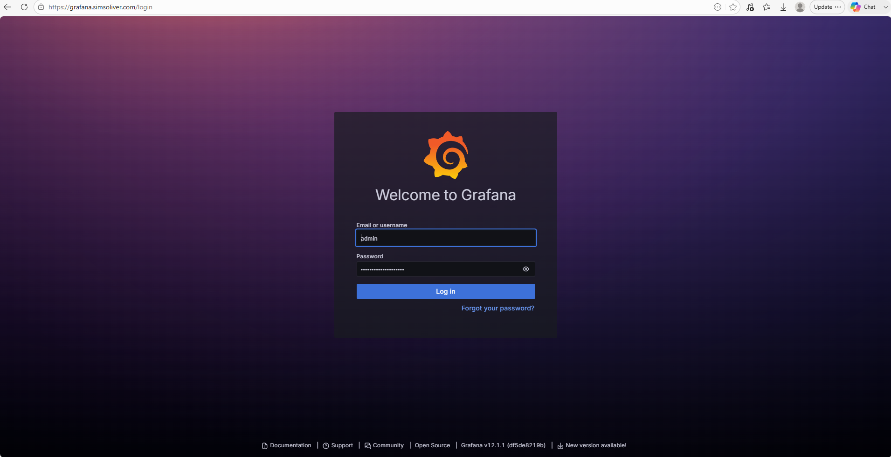
<br/><sub>Grafana login</sub>
</td>
</tr>
<tr>
<td align="center" valign="top" width="50%">
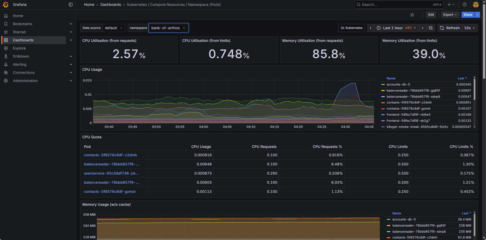
<br/><sub>CPU / memory</sub>
</td>
<td align="center" valign="top" width="50%">
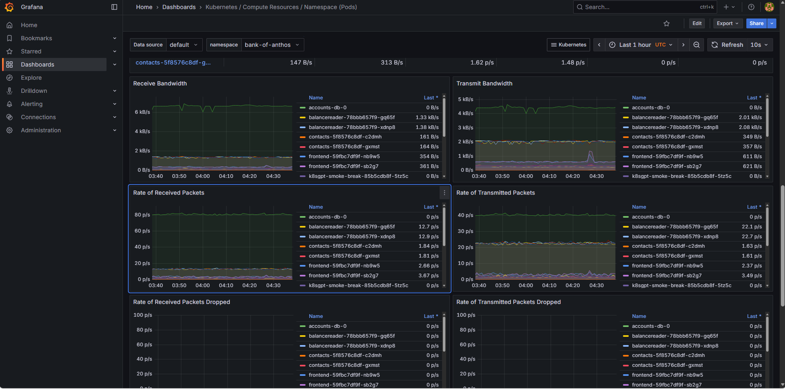
<br/><sub>Network</sub>
</td>
</tr>
</table>

---

## 9. Logs

Grafana Alloy ships pod logs to Loki. Grafana Explore filters on `namespace=bank-of-anthos` and `service_name`.

<table>
<tr>
<td align="center" valign="top" width="33%">
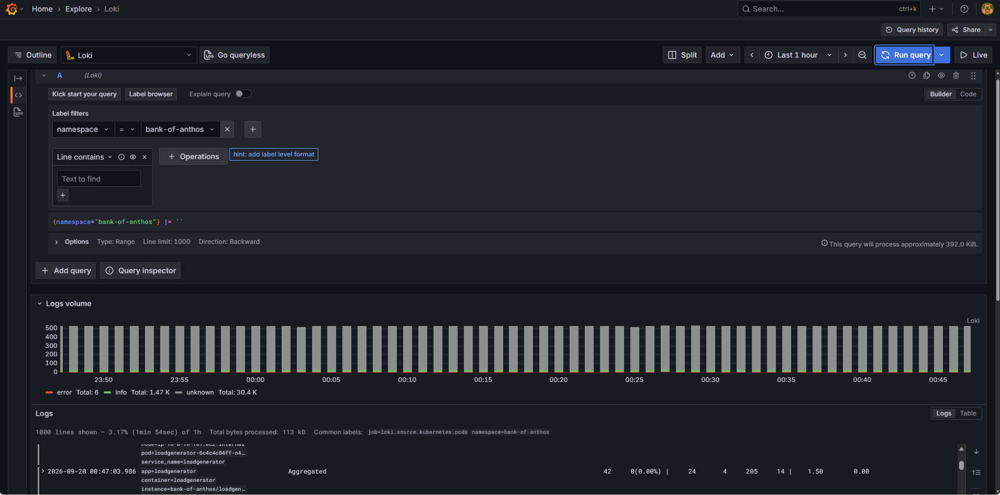
<br/><sub>Explore</sub>
</td>
<td align="center" valign="top" width="33%">
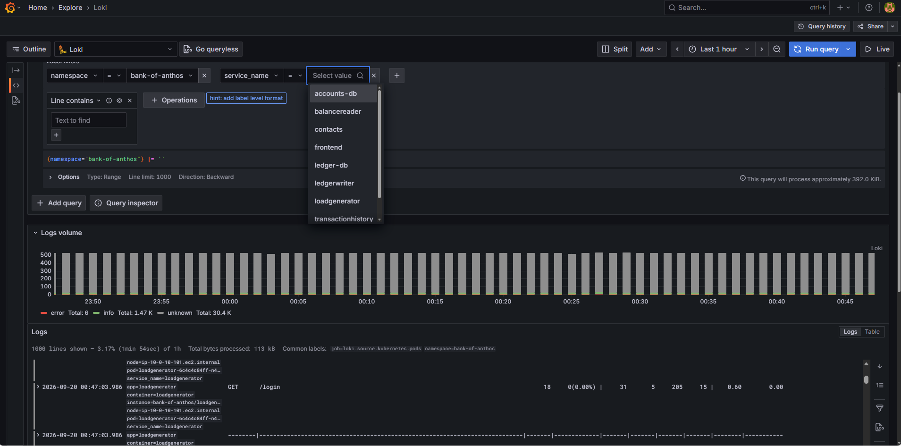
<br/><sub>Labels</sub>
</td>
<td align="center" valign="top" width="33%">
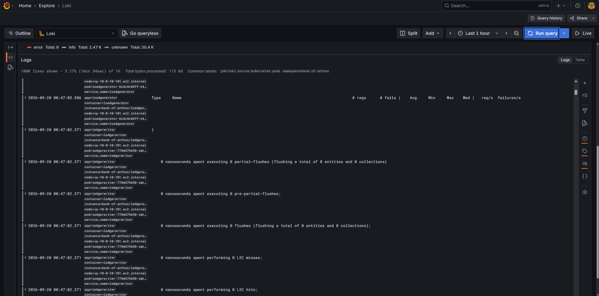
<br/><sub>Log lines</sub>
</td>
</tr>
</table>

---

## 10. Traces

Application services export spans to Zipkin (`zipkin.simsoliver.com` during the run).

<table>
<tr>
<td align="center" valign="top" width="50%">
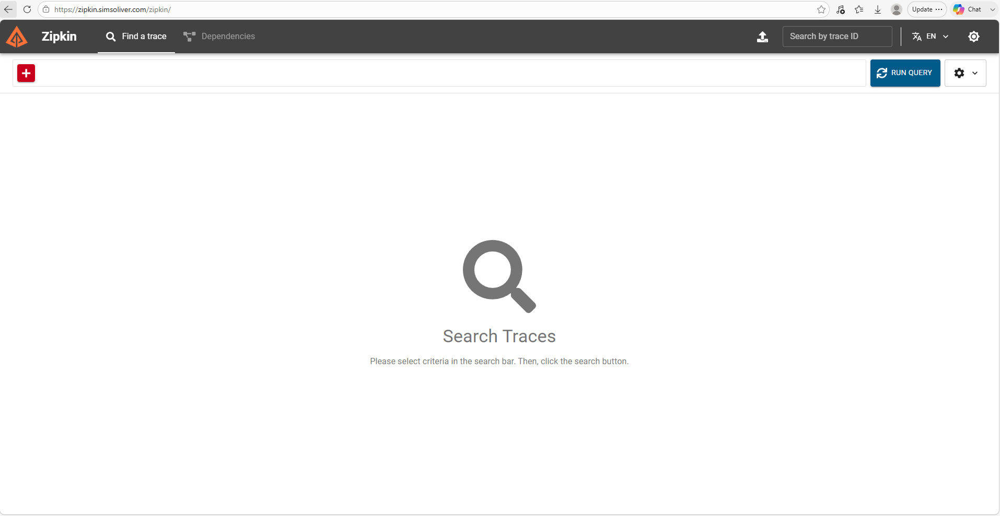
<br/><sub>Zipkin UI</sub>
</td>
<td align="center" valign="top" width="50%">
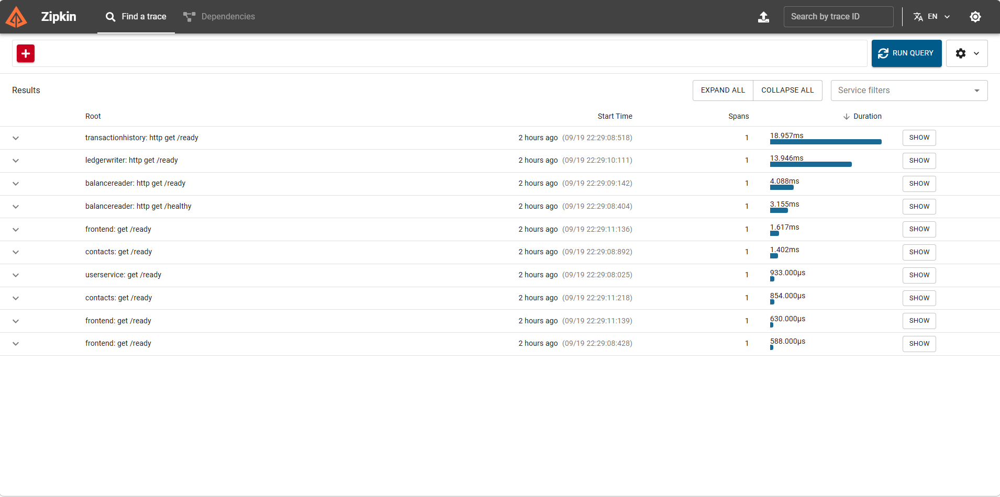
<br/><sub>Ready / health spans</sub>
</td>
</tr>
</table>

---

## 11. AIOps

k8sgpt analyzes Kubernetes objects and posts a report, error, and suggested fix to Slack `#k8sgpt`. Alertmanager sends Prometheus alerts to Slack `#alert`.

<table>
<tr>
<td align="center" valign="top" width="50%">
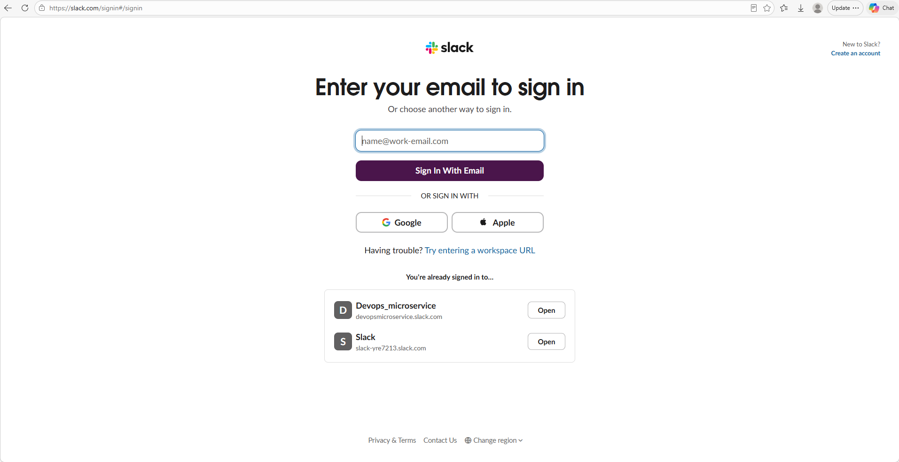
<br/><sub>Slack sign-in</sub>
</td>
<td align="center" valign="top" width="50%">
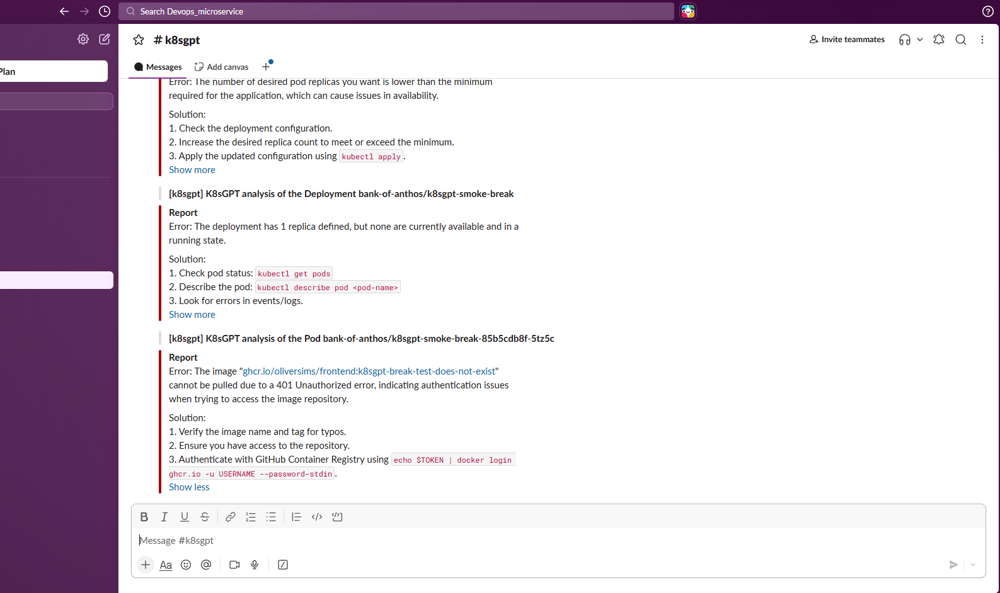
<br/><sub>k8sgpt → Slack `#k8sgpt`</sub>
</td>
</tr>
</table>

### How k8sgpt works here

k8sgpt is cluster diagnostics, not a metrics store. Prometheus reports CPU or a down target. k8sgpt reads objects and events, then explains the failure and the next `kubectl` steps.

It runs in namespace `monitoring`, installed by Terraform (Helm `k8sgpt-operator` and a `K8sGPT` CR from `k8sgpt/k8sgpt.yaml`). Argo CD does not sync it.

| Setting | Value |
|---------|--------|
| Scope | `targetNamespace: bank-of-anthos` only |
| Analyzers | Pod, Deployment, StatefulSet, Ingress, PVC |
| Omitted | HPA, logs, Service, DaemonSet (avoids noise at HPA min replicas) |
| Interval | 30 minutes, cache enabled |
| Model | OpenAI `gpt-4o-mini` |
| Sink | Slack Incoming Webhook → `#k8sgpt` |

Secrets stay in AWS Secrets Manager (`bank-dev-k8sgpt-openai`, `bank-dev-k8sgpt-slack`). ServiceAccount `k8sgpt` uses **Pod Identity** to read them. Secrets Store CSI syncs Kubernetes secrets `k8sgpt-openai` and `k8sgpt-slack`. Extra RBAC allows IngressClass, PV, event, and metrics-API reads so `alb` is not reported as missing.

```text
                     AWS Secrets Manager
                     bank-dev-k8sgpt-openai
                     bank-dev-k8sgpt-slack
                              │
                              │  Pod Identity  (SA k8sgpt)
                              ▼
                     Secrets Store CSI
                     k8sgpt-openai  /  k8sgpt-slack
                              │
ns monitoring                 │
                              ▼
                     k8sgpt-operator
                              │
                              │  K8sGPT CR  (every 30m)
                              │  filters: Pod, Deployment,
                              │           StatefulSet, Ingress, PVC
                              ▼
                     k8sgpt analyzer  ──scans──►  ns bank-of-anthos
                              │
                              ├──────────────►  OpenAI  (gpt-4o-mini)
                              │                      explain error + fix
                              │
                              └──────────────►  Slack webhook
                                                     │
                                                     ▼
                                               Slack  #k8sgpt
```

Alertmanager is a separate path: Prometheus rules → Slack `#alert`. Two channels: symptoms versus explained cluster objects.

---

## 12. High availability

Stateless Deployments use `replicas: 2` (HPA floor 2), `topologySpreadConstraints` (`maxSkew: 1`, `minDomains: 2`) across zones and hostnames, and PodDisruptionBudgets.

AZ spread is checked from a script in the private repository.

<table>
<tr>
<td align="center" valign="top" width="50%">
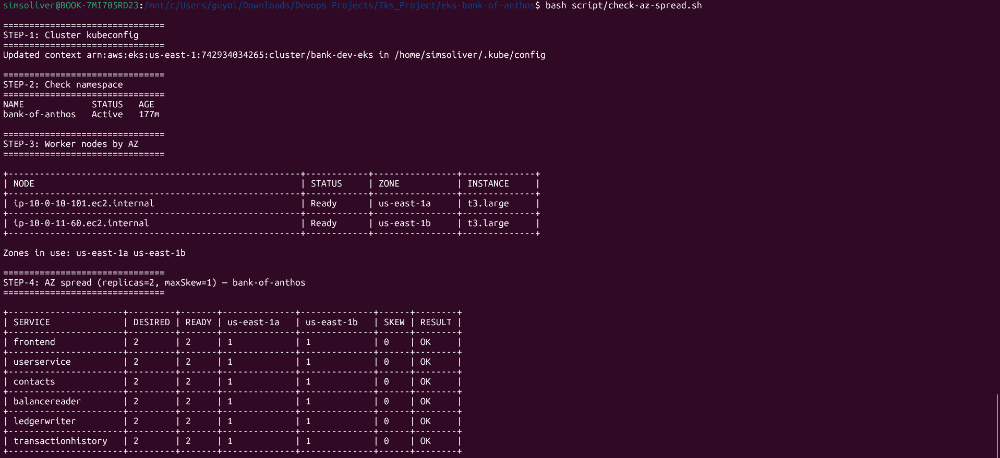
<br/><sub>Nodes by AZ and per-service spread</sub>
</td>
<td align="center" valign="top" width="50%">
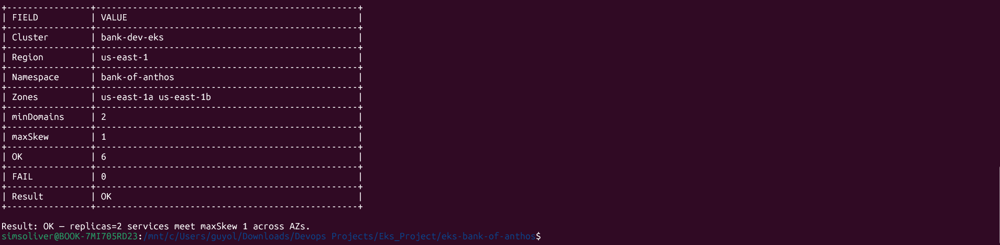
<br/><sub>Result: OK</sub>
</td>
</tr>
</table>

---

## 13. Restore and tear down

Ordered apply and destroy scripts, plus the restore and teardown runbooks, stay in the private repository.

**Restore (private repo)**

1. Apply the Terraform state bucket (once)
2. Apply stacks in blast-radius order
3. Set the ACM ARN on the frontend Ingress and push
4. Register the Git repo and Argo CD Applications
5. Verify HTTPS endpoints

**Tear down (private repo)**

1. Remove the application and frontend Ingress
2. Destroy Terraform stacks in reverse order

---

## 14. End-to-end flow

From commit to HTTPS, then into metrics, logs, traces, and Slack:

```text
Developer  →  GitHub (main)     private repo (oliversims)
               │
               ├─ GitHub Actions  →  Skaffold matrix (9 images)
               │                         build / push
               │                         │
               │                         ▼
               │                    GHCR
               │                    ghcr.io/oliversims/<service>:sha-<commit>
               │                         │
               │                    bot commit (manifest tags)  ←──┘
               │                              │
               └──────────────►  Argo CD  ◄───┘
                                      │
                         ┌────────────┴────────────┐
                         ▼                         ▼
              Application bank-of-anthos      Application ingress
              path: bank-of-anthos/           path: ingress/
                         │                         │
                         ▼                         ▼
                   ns bank-of-anthos          frontend Ingress + ACM
                         │                         │
                         │                         ▼
                         │              ALB bank-of-anthos
                         │              https://bank.simsoliver.com
                         │
                         ▼
         frontend · userservice · contacts · loadgenerator
         balancereader · ledgerwriter · transactionhistory
         accounts-db · ledger-db
                         │
                         ├─ metrics  →  Prometheus  →  Grafana
                         ├─ logs     →  Alloy → Loki  →  Grafana
                         ├─ traces   →  Zipkin
                         ├─ alerts   →  Alertmanager  →  Slack #alert
                         └─ AIOps    →  k8sgpt        →  Slack #k8sgpt
```

Grafana, Zipkin, and Argo CD share ALB `platform-tools` on `*.simsoliver.com`. Terraform creates the VPC, EKS, secrets, observability, and Argo CD before GitOps: `vpc → certs → eks → secrets → observability → argocd`.

---

## 15. What this project demonstrates

- Multi-stack Terraform with remote state and clear blast-radius boundaries
- EKS platform engineering (Load Balancer Controller, ExternalDNS, EBS CSI, Secrets Store CSI, Karpenter, Pod Identity)
- GitOps with Argo CD Applications and an automated GHCR image pipeline
- HTTPS edge with ACM and dual ALB separation (application vs platform tools)
- Polyglot microservices on EKS (Python, Java, Postgres)
- Observability loop: metrics, logs, traces, Slack alerting, and k8sgpt
- HA-aware scheduling validated with topology-spread checks

---

*oliversims · EKS Bank of Anthos Platform*
